<div align="center">

<picture>
  <source media="(prefers-color-scheme: dark)" srcset=".github/assets/banner-dark.svg">
  
</picture>

**An optional native navigation drawer for PAM Native.**<br>
Routes, groups, gestures, back handling, state restoration and a responsive permanent layout, moved out of the core into its own plugin.

[](https://packagist.org/packages/pushinbr/pam-native-drawer)
[](https://github.com/push-in/pam-native-drawer/releases/latest)

[](LICENSE)

[Install](#install) · [Quick example](#quick-example) · [Platforms](#platform-support) · [Docs](#docs) · [Issues](https://github.com/push-in/pam-native-drawer/issues)

</div>

<a id="install"></a>
## <picture></picture> Install

Inside a PAM Native project, add only this capability:

```sh
pam composer require pushinbr/pam-native-drawer
pam doctor --fix
```

Composer and the PAM launcher discover `pam-native.plugin.json`, register the PHP provider and compile the native sources; there is no manual module installation. Rebuild the native host after adding the package. New to PAM? Create a project with `pam init my-app --template native` (see the [PAM Native overview](https://push-in.github.io/pam-docs/native/overview/)).

<a id="quick-example"></a>
## <picture></picture> Quick example

```php
use Pam\Native\Drawer\DrawerRouter;
use Pam\Native\Drawer\DrawerType;
use Pam\Native\UI\{Screen, Text};

$navigator = (new DrawerRouter('home'))
    ->route('home', 'Home', Screen::make(Text::make('Home')))
    ->route('settings', 'Settings', Screen::make(Text::make('Settings')))
    ->presentation(DrawerType::Front)
    ->responsive(840)
    ->build();
```

`DrawerRoutes::make()` and `DrawerRoutes::screen()` offer declarative groups. `DrawerLayoutAndroid::make($content, $drawer)` is the basic host on both platforms; the historical name is preserved. The provider also registers `<DrawerLayoutAndroid>`. The enums and `NavigationDrawerItem` live in `Pam\Native\Drawer`.

<a id="platform-support"></a>
## <picture></picture> Platform support

| Platform | Support | Notes |
| --- | --- | --- |
| Android | API 26+ | Native view `drawer`; animations cancelled when leaving the window |
| iOS | 15.0+ | UIKit; children inserted through `NativeChildHost` |
| PAM Native | 1.46.6 to < 2.0.0 | From `pam-native.plugin.json` (1.46.6 moved the drawer out of the core); PHP 8.5+ |

<a id="requirements"></a>
## <picture></picture> Requirements

No runtime permissions: the plugin declares no Android permissions or iOS usage descriptions. It registers one native view, `drawer`.

<a id="behavior"></a>
## <picture></picture> Behavior

The plugin preserves gestures, back, groups, restoration and responsive presentation. Android cancels animations when leaving the window. The host receives properties and events through `NativePropertyView`; iOS inserts children through the generic `NativeChildHost` hook. The historical protocol IDs stay reserved and are not renumbered.

<a id="migration"></a>
## <picture></picture> Migration and compatibility

The old core names are `MovedToPlugin` shims for one minor version. With the plugin installed they become aliases and emit a deprecation; without it, the error tells you to install `pushinbr/pam-native-drawer`. Migrate imports to `Pam\Native\Drawer`. No dependency of this plugin is imposed on other apps.

<a id="tests"></a>
## <picture></picture> Tests

The PHP regressions moved to `tests/core-compat.php`. To run them, use PHP 8.5 in the framework checkout:

```sh
PAM_TEST_PLUGIN_ROOTS=/path/to/this-plugin php packages/native/tests/run.php
```

Android tests live in `android/src/test` or `android/src/androidTest`, depending on the package. Instrumented tests need a PAM test host. The `ios/Package.swift` test package accepts `PAM_NATIVE_CORE=/checkout/core`. Run the Swift tests on an iOS simulator; the test module is independent of the module name the launcher generates in the production host.

Emulator validation must cover light/dark theme, keyboard and safe areas, reduced motion, screen replacement and dismissal. See [`RELATORIO.md`](RELATORIO.md) (Portuguese) for the evidence actually executed for this version.

<a id="docs"></a>
## <picture></picture> Docs

- [Validation report (RELATORIO.md, Portuguese)](RELATORIO.md)
- [PAM Native overview](https://push-in.github.io/pam-docs/native/overview/)
- [PAM introduction](https://push-in.github.io/pam-docs/introduction/)
- [Report an issue](https://github.com/push-in/pam-native-drawer/issues)

<a id="pam-ecosystem"></a>
## <picture></picture> Part of the PAM ecosystem

PAM runs PHP natively on servers, desktops and phones. This repository is one piece of it.

| [**PAM**](https://github.com/push-in/pam) | [**PAM Desktop**](https://github.com/push-in/pam-desktop) | [**PAM Native**](https://github.com/push-in/pam-native) | [**Ecosystem**](https://github.com/push-in/pam#ecosystem) |
| --- | --- | --- | --- |
| the runtime and CLI | native desktop apps in PHP | native Android and iOS apps in PHP | every official package and plugin |

<sub>Docs: [push-in.github.io/pam-docs](https://push-in.github.io/pam-docs/introduction/) · [Issues](https://github.com/push-in/pam-native-drawer/issues)</sub>

<p align="center"><sub><a href="LICENSE">Apache License 2.0</a> · Made in Brazil by Pushin</sub></p>
